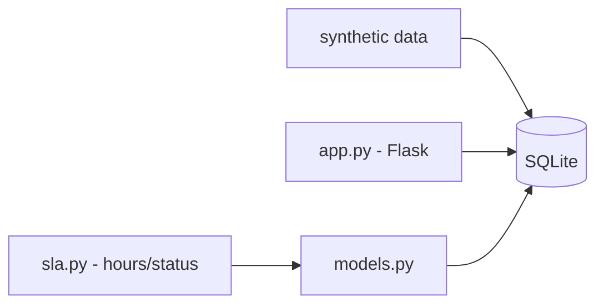

# dashboard-sla-helpdesk

**English** · [Português (Brasil)](README.md)

[](#) [](#) [](#) [](LICENSE)

## What it is

**A small SLA dashboard for a helpdesk**: it generates synthetic tickets, stores them in SQLite, computes SLA per severity and exposes a Flask API to query tickets and whether they were handled in time. It is an educational backend/API lab.

## Status

An educational lab, working and tested (22 tests).

## Features

- **Data model** (`models.py`): `criar_ticket`, `atualizar_status`, `listar_tickets`, `obter_ticket`.
- **SLA calculation** (`sla.py`): `compute_sla_hours(severity)` and `is_within_sla(created, resolved, severity)`.
- **SQLite DB** (`db.py`): `get_connection`, `init_db`.
- **Flask API** (`app.py`): `create_app(db_path)`; create and query tickets.
- **Synthetic data generation**: populates the database for the dashboard.

## Architecture

A `dashboard_sla_helpdesk` package with `db` (SQLite), `models` (ticket operations), `sla` (calculation) and `app` (Flask API), plus synthetic data in `data/`.



## Stack

- Python ≥ 3.10
- Flask ≥ 3.0 (only dependency; SQLite and the rest via stdlib)
- pytest (dev)

## Repository layout

```
dashboard-sla-helpdesk/
├── pyproject.toml · BRIEF.md
├── src/dashboard_sla_helpdesk/
│   ├── db.py · models.py · sla.py · app.py
├── data/             # synthetic data
├── tests/            # 22 tests
└── LICENSE           # MIT
```

## Prerequisites and installation

```bash
pip install -e .
```

## How to run

```bash
python -m dashboard_sla_helpdesk
# starts the Flask API with the dashboard
```

## Tests and quality

```bash
PYTHONPATH=src python -m pytest tests/
# 22 passed
```

## Technical decisions and trade-offs

- SQLite + Flask: a light stack with no external service; suited to a lab.
- SLA by severity: simple, testable rules instead of ML.

## Known limitations

- Synthetic data (not from a real helpdesk).
- SLA computed by severity with fixed rules; no per-contract/dynamic configuration.

## Development process

An individual project by Kelvin Oliveira, built with orchestrated AI agents and reviewed by the author.

## License and author

MIT — Copyright (c) 2026 Kelvin Rebelo de Oliveira. Author: [Kelvin Oliveira](https://github.com/KelvinOliveiraCode) · [Portfolio](https://kelvinoliveiracode.github.io/portfolio/)
