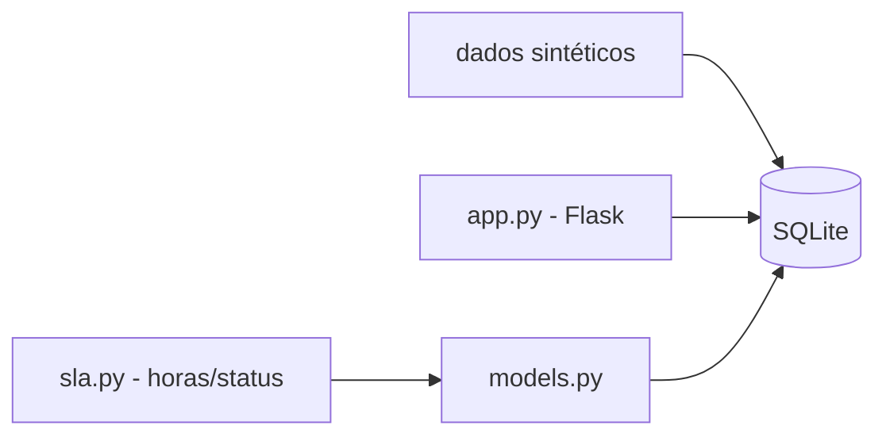

# dashboard-sla-helpdesk

[English](README.en.md) · **Português (Brasil)**

[](#) [](#) [](#) [](LICENSE)

## O que é

**Mini dashboard de SLA para helpdesk**: gera tickets sintéticos, salva em SQLite, calcula o SLA por severidade e expõe uma API Flask para consultar tickets e o status de atendimento dentro ou fora do prazo. É um laboratório educacional de backend/API.

## Status

Laboratório educacional funcional e testado (22 testes).

## Funcionalidades

- **Modelo de dados** (`models.py`): `criar_ticket`, `atualizar_status`, `listar_tickets`, `obter_ticket`.
- **Cálculo de SLA** (`sla.py`): `compute_sla_hours(severity)` e `is_within_sla(created, resolved, severity)`.
- **Banco SQLite** (`db.py`): `get_connection`, `init_db`.
- **API Flask** (`app.py`): `create_app(db_path)`; consulta e criação de tickets.
- **Geração de dados sintéticos**: preenche o banco para o dashboard.

## Arquitetura

Pacote `dashboard_sla_helpdesk` com `db` (SQLite), `models` (operações de ticket), `sla` (cálculo) e `app` (Flask API), mais dados sintéticos em `data/`.



## Stack

- Python ≥ 3.10
- Flask ≥ 3.0 (única dependência; SQLite e restante via stdlib)
- pytest (dev)

## Estrutura do repositório

```
dashboard-sla-helpdesk/
├── pyproject.toml · BRIEF.md
├── src/dashboard_sla_helpdesk/
│   ├── db.py · models.py · sla.py · app.py
├── data/             # dados sintéticos
├── tests/            # 22 testes
└── LICENSE           # MIT
```

## Pré-requisitos e instalação

```bash
pip install -e .
```

## Como executar

```bash
python -m dashboard_sla_helpdesk
# sobe a API Flask com o dashboard
```

## Testes e qualidade

```bash
PYTHONPATH=src python -m pytest tests/
# 22 passed
```

## Decisões técnicas e trade-offs

- SQLite + Flask: pilha leve e sem serviço externo; adequada a laboratório.
- Cálculo de SLA por severidade: regras simples e testáveis, em vez de ML.

## Limitações conhecidas

- Dados sintéticos (não de um helpdesk real).
- SLA calculado por severidade com regras fixas; sem SLAs por contrato/configuração dinâmica.

## Processo de desenvolvimento

Projeto individual de Kelvin Oliveira, construído com agentes de IA orquestrados e revisado pelo autor.

## Licença e autor

MIT — Copyright (c) 2026 Kelvin Rebelo de Oliveira. Autor: [Kelvin Oliveira](https://github.com/KelvinOliveiraCode) · [Portfólio](https://kelvinoliveiracode.github.io/portfolio/)
